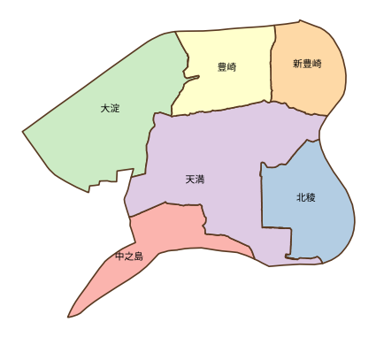
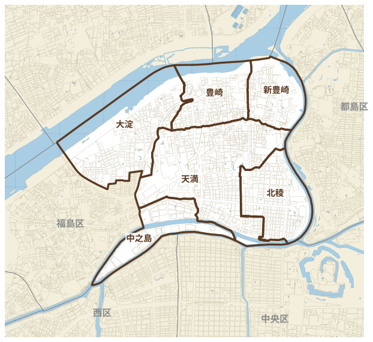

# osaka-chugakku

大阪市の**中学校区ポリゴン**と、区別地図用の**背景地図レイヤー**を、公開データだけから作成したものです。
QGIS でそのまま使える GeoPackage と、作成に使った Python スクリプトをまとめています。

 

## データ（`data/`）

| ファイル | 内容 |
|---|---|
| `chugakku_seamless.gpkg` | **すき間のない中学校区**。`中学校区_区別`（区×校区 136件）、`中学校区_全体`（127校）、`区境界` |
| `chugakku_gaiku.gpkg` | 街区ごとに中学校を割り当てたもの。`街区_中学校`（判定列つき）、`中学校区_街区から作成`、`街区代表点_中学校` |
| `gaiku_chugakko.csv` | 町丁目・番 → 中学校 の対応表（25,138街区） |
| `chocho_chugakko.csv` | 町丁目 → 中学校 の対応表（町丁目単位の簡易版） |
| `gaiku_osaka.gpkg` | 道路縁から作った番号つき街区ポリゴン |
| `haikei_osaka.gpkg` | 背景地図（中学校区・区境界・街区・水域・地の色）。**スタイル埋め込み済み** |
| `koen_osaka.gpkg` | 公園ポリゴン（OpenStreetMap）。スタイル埋め込み済み |
| `legend.svg` | 区別地図の凡例 |
| `tsugakukuiki_R6_raw.json` | 通学区域一覧PDFから読み取った表の生データ |

座標系はいずれも **JGD2011 平面直角座標系 第VI系（EPSG:6674）** です（`街区_代表点` などの一部を除く）。

### 背景地図の使い方
1. `haikei_osaka.gpkg` と `koen_osaka.gpkg` を QGIS にドラッグ＆ドロップ
2. レイヤーを `01 → 02 → 04 → 公園 → 05 → 06` の順（01が一番上）に並べる
3. ［プロジェクト］→［プロパティ］→［変数］で `target_ku` に区名（例：`北区`）を設定すると、その区が白くなり校区が表示されます
4. 印刷レイアウトのアトラスでは自動で `@atlas_pagename` が使われます（ページ名＝区名）

道路縁はファイルサイズが大きいため含めていません。必要な場合は基盤地図情報の「道路縁」をダウンロードし、`scripts/10_fgd_to_gpkg.py` で変換して重ねてください。

## 精度と注意
- 中学校の割り当ては**街区（番）単位**です。`号` 単位で分かれる街区（約170か所）や、1つの面に複数の番が入った街区は、`判定` 列で確認できます。
- すき間のない校区は、街区のあいだの道路・川を**近い方の街区の校区に振り分けて**作っています（ボロノイ分割）。異なる校区のあいだの道路は、ほぼ中央で分かれます。
- 元資料は **令和6年4月1日現在** の通学区域一覧です。最新の通学区域は大阪市教育委員会の資料で確認してください。
- 本データは個人が作成したもので、大阪市の公式データではありません。

## 作り方（`scripts/`）

```
通学区域一覧PDF ─ 01_extract_pdf.py → raw.json
                   ├ 02_parse_chocho.py / 03_chocho_table.py → 町丁目単位の表
                   └ ban_parse.py（番単位に分解）
基盤地図情報 ─ 10_fgd_to_gpkg.py → 水域・道路縁など
街区レベル位置参照情報 + 道路縁 ─ 11_gaiku_polygon.py → 番号つき街区ポリゴン
                   └ 12_assign_chugakko.py → 街区ごとの中学校・CSV
区境界 ─ 13_fill_seamless.py → すき間のない中学校区
20_haikei_layers.py / 21_embed_styles.py → 背景地図GeoPackage（スタイル埋め込み）
qgis_make_haikei.py → QGIS上で背景地図を組み立てるスクリプト
make_legend.py → 凡例SVG
```

必要なライブラリ：`geopandas`, `pyogrio`, `shapely>=2.1`, `pdfplumber`（PDF読み取り）

## 出典・ライセンス

| データ | 出典 | ライセンス |
|---|---|---|
| 通学区域一覧（令和6年度） | 大阪市教育委員会 | — |
| 基盤地図情報（水域・道路縁） | 国土地理院 | 国土地理院コンテンツ利用規約 |
| 街区レベル位置参照情報（2024年度） | 国土交通省 | 位置参照情報ダウンロードサービスの利用規約 |
| 行政区域（区境界） | 国土交通省 国土数値情報 N03（[niiyz/JapanCityGeoJson](https://github.com/niiyz/JapanCityGeoJson) 経由） | CC BY 4.0 |
| 公園（`koen_osaka.gpkg`） | © OpenStreetMap contributors | [ODbL 1.0](https://opendatacommons.org/licenses/odbl/) |

このリポジトリのデータは上記を加工して作成したものです。利用するときは上記の出典を表示してください。
`koen_osaka.gpkg` は ODbL に従います。

スクリプトは MIT License です。
